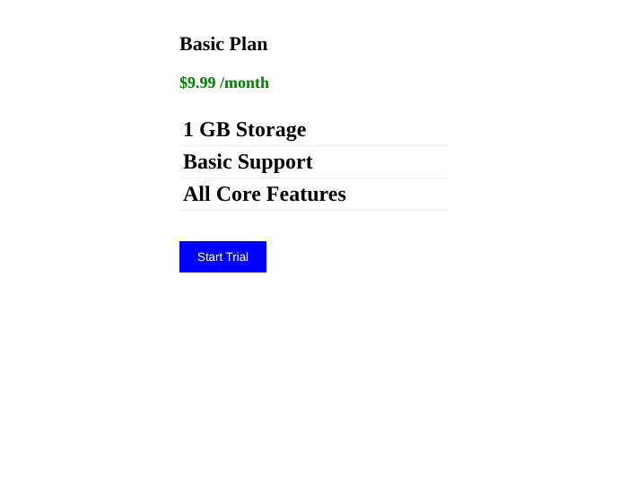
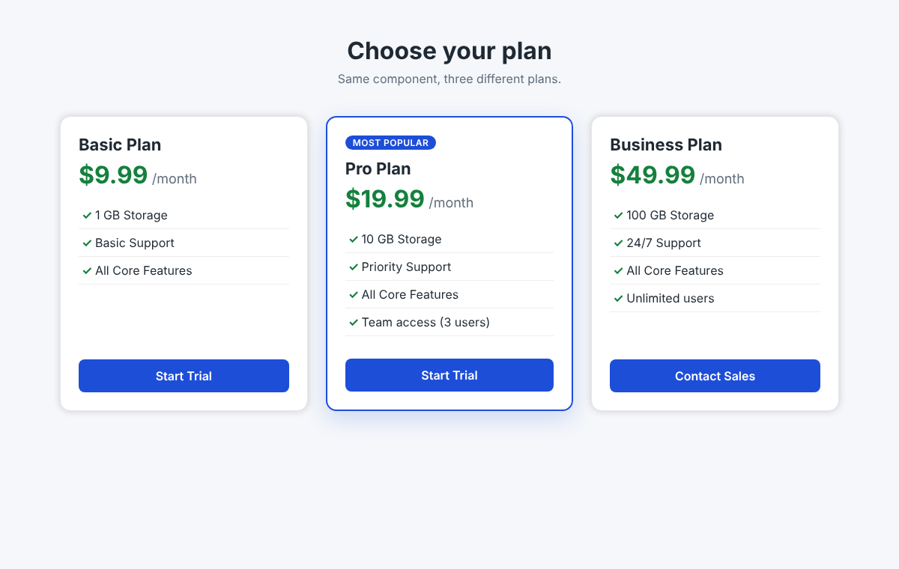
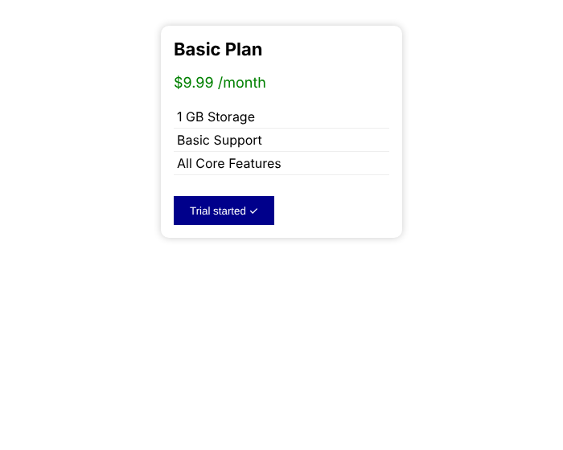
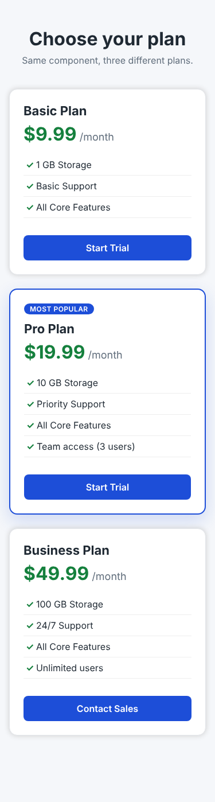
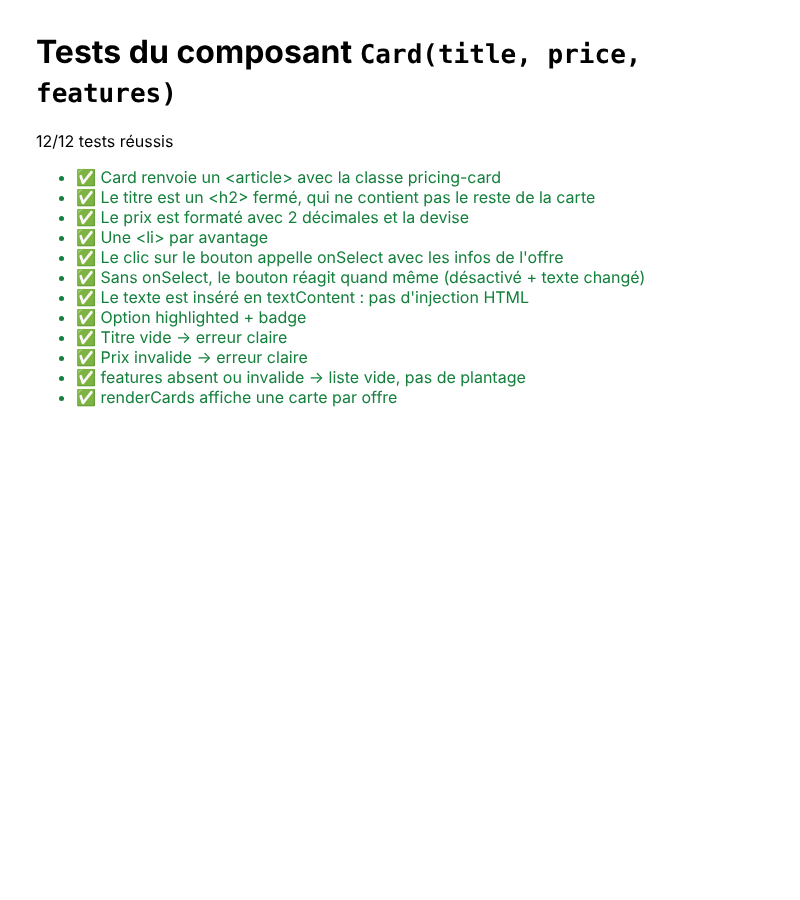

# Checkpoint : Best Practices and Workflow Optimization with AI

On reçoit une **carte de prix cassée** : sa mise en page est défectueuse et son bouton ne répond pas. Le but est de la **réparer**, de la **refactoriser** en composant réutilisable `Card(title, price, features)` et de la **tester**, avec l'aide de l'IA.

## Contenu du dépôt

| Fichier | Rôle |
|---|---|
| [`avant/index.html`](avant/index.html) | Le code d'origine, cassé, sans aucune modification |
| [`apres/carte-corrigee.html`](apres/carte-corrigee.html) | Étape 1 : les bugs corrigés, même structure (commentaires `FIX`) |
| [`apres/card.js`](apres/card.js) | Étape 2 : le composant réutilisable `Card(title, price, features, options)` et `renderCards()` |
| [`apres/card.css`](apres/card.css) | Les styles du composant (variables CSS, responsive) |
| [`apres/index.html`](apres/index.html) | Le nouveau fichier de démonstration : 3 offres créées avec le même composant |
| [`apres/test.html`](apres/test.html) | 12 tests du composant, exécutés dans le navigateur |
| [`PROMPTS.md`](PROMPTS.md) | Les prompts IA utilisés, étape par étape |
| [`captures/`](captures) | Les captures avant et après |

## Bugs trouvés et corrigés

| # | Bug dans le code d'origine | Effet visible | Correction |
|---|---|---|---|
| 1 | `<h2 class="title">Basic Plan<h2>` : la balise n'est pas fermée, un 2e `<h2>` s'ouvre | Le prix, la liste et le bouton se retrouvent **dans un titre** : texte énorme et en gras | `</h2>` |
| 2 | `box-shdow` (faute de frappe) | Pas d'ombre, la carte se confond avec le fond | `box-shadow` |
| 3 | `width: 300px` fixe et pas de `box-sizing` | La carte n'est pas responsive et le padding la fait déborder | `width: 100%` + `max-width`, `box-sizing: border-box` |
| 4 | Pas de `lang`, `charset` ni `viewport` | Rendu mobile non adapté, accents mal gérés | En-tête HTML complet |
| 5 | Le bouton n'a ni `type` ni gestionnaire de clic, ni `cursor: pointer` | Le bouton **ne répond pas** | `addEventListener("click", …)` + retour visuel |
| 6 | Pas de style `:focus-visible` | On ne voit pas le bouton quand on navigue au clavier | Contour de focus visible |

## Le composant

```js
// Minimal : exactement la signature demandée
const card = Card("Basic Plan", 9.99, ["1 GB Storage", "Basic Support", "All Core Features"]);
document.querySelector("#pricing").append(card);

// Avec options
Card("Pro Plan", 19.99, ["10 GB Storage", "Priority Support"], {
  highlighted: true,
  badge: "Most popular",
  buttonText: "Start Trial",
  onSelect: (plan) => console.log("Offre choisie :", plan.title),
});

// Plusieurs offres d'un coup, à partir de données
renderCards("#pricing", [
  { title: "Basic Plan", price: 9.99, features: ["1 GB Storage"] },
  { title: "Pro Plan", price: 19.99, features: ["10 GB Storage"], highlighted: true },
]);
```

**Bonnes pratiques appliquées :**
- **DRY** : une seule fonction pour toutes les offres. Ajouter une offre revient à ajouter un objet de données, sans toucher au HTML.
- **Sécurité** : le texte est inséré avec `textContent`, jamais avec `innerHTML`, donc aucune injection de HTML possible.
- **Garde-fous** : un titre vide ou un prix invalide déclenche une erreur claire. Si `features` est absent, la liste est vide et rien ne plante.
- **Sémantique et accessibilité** : `<article>` relié à son titre par `aria-labelledby`, bouton `type="button"` avec `aria-label`, focus visible, message annoncé avec `aria-live`.
- **CSS maintenable** : couleurs en variables, nommage BEM (`pricing-card__title`), grille responsive `auto-fit` / `minmax`, boutons alignés en bas grâce à `flex: 1`.

## Tester

Ouvrir `apres/index.html` dans le navigateur et cliquer sur un bouton. Ouvrir `apres/test.html` pour voir les 12 tests (12 sur 12 réussis).

## Captures

| Avant | Après (ordinateur) |
|---|---|
|  |  |

| Étape 1 : carte corrigée | Après (mobile) | Tests |
|---|---|---|
|  |  |  |
